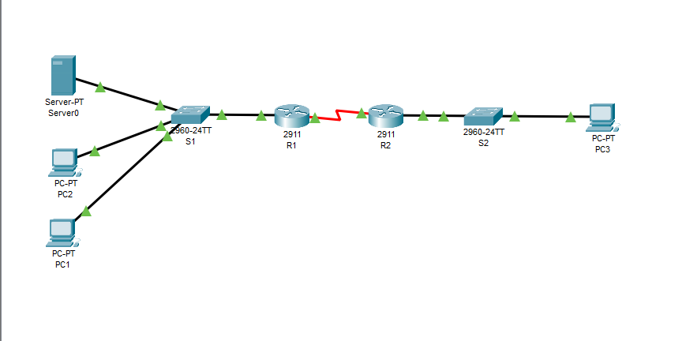

# VLAN DESIGNING PRACTICE

my handwork!

# پاسخ به سوالات تمرین

1. چرا قبل از ایجاد VLAN تمام دستگاه ها میتوانستند با بکدیگر ارتباط برقرار کنند؟

زیرا تمام پورت های سوئیج در VLAN پیشفرض 1 قرار داشتند و دسگاه ها در یک Broadcast Domain مشترک بودند!

2. چرا بعد از ایجاد VLAN ارتباط بین PC1, Server0 بدون روتر برقرار نمیشد؟

زیرا PC1 و Server0 در VLAN های متفاوت قرار داشتند. ارتباط بین شبکه های متفاوت به دستگاه لایه 3 مانند روتر نیاز دارد!

3. چرا برای ارتباط بین VLAN ها به روتر نیار داریم؟

سوئیچ لایه 2 فریم ها را بر اساس  MAC Address انتقال میدهد. اما روتر در لایه 3 و بر اساس IP Address بین شبکه های مختلف مسیر یابی میکند!

4. تفاوت Trunk و Access چیست؟

Access: برای اتصال دستگاه های انتهایی به سوئیچ استفاده میشود و متعلق به یک VLAN است.

Trunk: برای انتقال ترافیک چند VLAN از یک لینک با استفاده از استاندارد 802.1Q استفاده میشود.

5. دستور `encapsulation dot1Q 10` چه کاری انجام میدهد؟

مشخص میکند که Subinterface روتر باید فریم های متعلق به VLAN 10 را با استفاده از استاندارد IEEE 802.1Q پردازش کند.

6. چرا به Static Route برگشت نیاز داریم؟

زیرا ارتباط شبکه دو طرفه است. روتر مقصد باید مسیر بازگشت به شبکه مبدا را بداند تا بتواند پاسخ بسته ها را ارسال کند.

7. تفاوت Static Routing , RIP چیست؟

Static Routing: مسیر ها به صورت دستی توسط مدیر شبکه تعریف میشوند.

RIP: یک پروتوکل مسیریابی پویاست که مسیرها را با تبادل اطلاعات بین روتر ها یاد میگیرد و بر اساس تعداد Hop تصمیم گیری میکند.

8. اگر لینک بین دو روتر قطع شود، Static Routing چه رفتاری دارد ؟

ارتباط بین دو شبکه قطع میشود و مسیر Static دیگر قابل استفاده نخواهد بود، مگر اینکه مسیر جایگزین تعریف شده باشد.