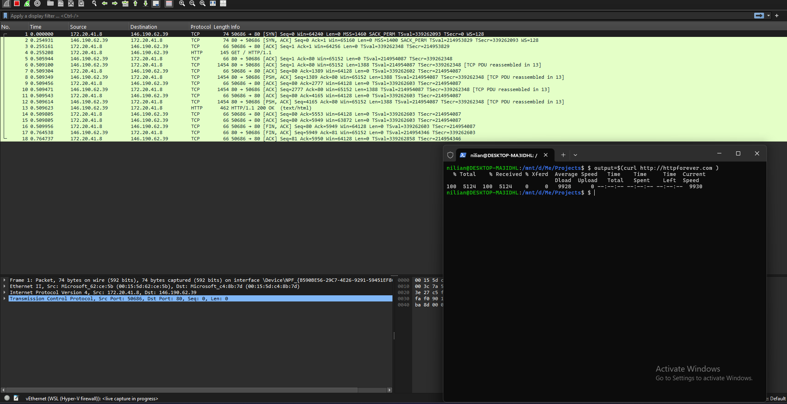

# Network Protocols - Practical Assignments

## Assignment 1: HTTP Packet Analysis with Wireshark

**Link**: [HTTP Packet Analysis with Wireshark](./docs/wireshark.md)

**Objective**: Capture and analyze HTTP network traffic to understand the request-response cycle.

**Summary**: Using Wireshark in a clean WSL environment, I captured HTTP packets while accessing `http://httpforever.com` via curl. The capture revealed the complete TCP handshake, HTTP GET request, server response with headers, and connection termination.

**Key Learnings**:
- HTTP operates as plaintext, making it visible in packet captures
- The TCP three-way handshake precedes every HTTP request
- HTTP headers contain valuable metadata about client-server communication

## Assignment 2: IoT Protocol Research

**Link**: [HTTP Packet Analysis with Wireshark](./docs/iot-protocols.md)

**Objective**: Research and document three fundamental protocols used in Internet of Things communications.

**Protocols Covered**:
- **MQTT** - Lightweight publish/subscribe messaging protocol
- **CoAP** - Constrained Application Protocol for resource-limited devices
- **LwM2M** - Device management and service enablement protocol

**Summary**: Each protocol serves different IoT needs—MQTT excels in reliable messaging, CoAP provides RESTful communication over UDP, and LwM2M adds comprehensive device management capabilities.

## Assignment 3: DNS Server Deployment

**Link**: [HTTP Packet Analysis with Wireshark](./docs/dns-server-setup/dns-server-setup.md)

**Objective**: Set up a functional DNS server using containerization technology.

**Implementation**: Deployed a Bind9 DNS server using Docker Compose with minimal configuration. Created a custom zone `homework.local` with A records pointing to specified IP addresses.

**Components**:
- Docker Compose file defining the Bind9 service
- Named.conf with basic options and zone definition
- Zone file with DNS records

**Result**: Successfully running DNS server that resolves local domain names to configured IP addresses.

