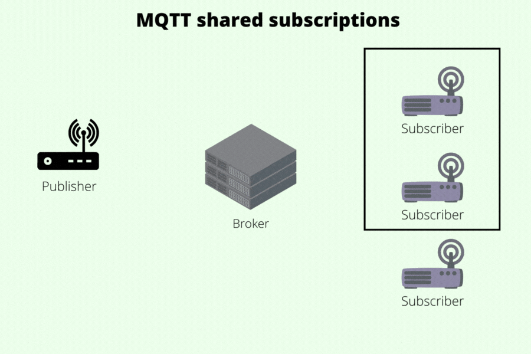
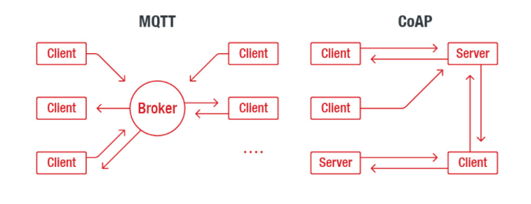
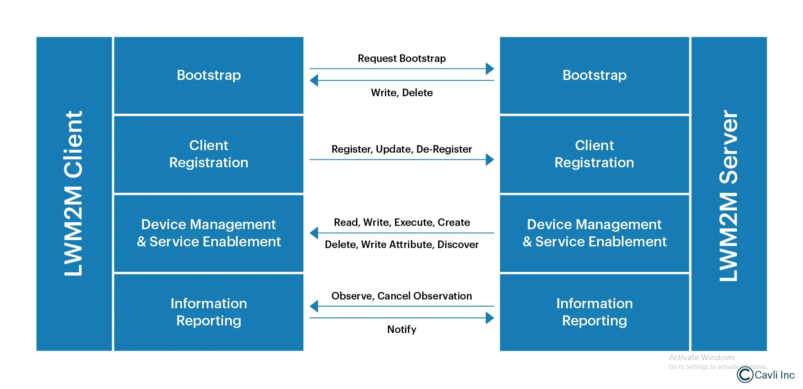

# Internet of Things Protocols: MQTT, CoAP, and LwM2M

## Document Overview

This document provides a technical overview of three fundamental protocols used in Internet of Things (IoT) and Machine-to-Machine (M2M) communication. Each protocol is designed for specific use cases and constrained environments.

## 1. MQTT (Message Queuing Telemetry Transport)

### Overview
MQTT is a lightweight publish/subscribe messaging protocol designed for low-power sensors and devices operating in low-bandwidth, high-latency, or unreliable network environments . It was originally developed by IBM in 1999 for oil and gas pipeline monitoring and became an OASIS standard in 2013 .

### Core Architecture
MQTT operates on a client-server model where clients never communicate directly. Instead, they connect to a central broker (server) that handles message distribution .

**Key Components:**
- **Publisher**: Client that sends messages
- **Subscriber**: Client that receives messages
- **Broker**: Central server that filters and distributes messages
- **Topic**: Hierarchical named channels (e.g., `sensors/COMPUTER_NAME/temperature/HARDDRIVE_NAME`) 

### Publish/Subscribe Pattern
The publish/subscribe model decouples message publishers from subscribers. Publishers send messages to specific topics without knowing which clients will receive them. Subscribers express interest in topics and receive relevant messages automatically. This asynchronous communication mechanism significantly saves network resources .

### Topic Wildcards
MQTT supports two wildcard characters for flexible subscriptions :

- **+** (single-level): Matches one hierarchy level
  - Example: `sensors/+/temperature/+` matches all computers and hard drives
- **#** (multi-level): Matches all remaining levels (must be final character)
  - Example: `sensors/#` matches everything under sensors

### Quality of Service (QoS) Levels
MQTT defines three QoS levels that determine delivery guarantees :

| Level | Name | Description |
|-------|------|-------------|
| **QoS 0** | At most once | Message delivered once with no confirmation; fire-and-forget |
| **QoS 1** | At least once | Message guaranteed to arrive at least once; may have duplicates |
| **QoS 2** | Exactly once | Four-step handshake ensures unique and reliable delivery |

Higher QoS levels provide greater reliability but increase latency and bandwidth requirements .

### Special Features

**Retained Messages**: When a message is published with the retained flag, the broker stores it. New subscribers matching that topic receive the message immediately, providing a "last known good" mechanism .

**Will Messages (Last Will and Testament)**: Clients can specify a will message during connection. If the client disconnects unexpectedly, the broker automatically publishes this message to notify other clients .

**Clean Session**: The "clean session" flag determines connection durability. When false, subscriptions and offline QoS 1/2 messages persist across disconnections. When true, all session data is removed upon disconnect .

### Technical Specifications
- **Transport**: TCP/IP (standard port 1883; TLS/SSL port 8883) 
- **Header Size**: Fixed 2-byte minimum, extremely lightweight 
- **ISO Standard**: ISO/IEC PRF 20922 
- **Latest Version**: MQTT 5.0 (2019), with enhanced cloud-native features 

### Applications
- **Smart Home**: Device state synchronization and control 
- **Industrial IoT (IIoT)** : Sensor data collection and equipment monitoring 
- **Healthcare**: Remote patient monitoring (e.g., cardiac devices) 
- **Automotive**: Vehicle telematics and remote diagnostics 
- **Mobile Notifications**: Push messaging for mobile applications 

## 2. CoAP (Constrained Application Protocol)

### Overview
CoAP is a specialized web transfer protocol designed for constrained nodes (8-bit microcontrollers with limited ROM/RAM) and constrained networks (low-power, lossy networks with high error rates and low throughput) . Standardized by IETF in RFC 7252, it enables machine-to-machine applications like smart energy and building automation .

### Design Philosophy
CoAP follows RESTful architecture similar to HTTP but optimized for IoT environments. It supports URI concepts and internet media types while providing multicast support, low overhead, and simplicity for constrained environments .

### Protocol Stack
CoAP typically runs over UDP (with optional SMS binding) and uses DTLS for security .

### Message Types
CoAP defines four message types for reliable communication over UDP :

| Type | Description |
|------|-------------|
| **CON** (Confirmable) | Requires ACK response; retransmitted until acknowledged |
| **NON** (Non-confirmable) | No acknowledgment required; fire-and-forget |
| **ACK** (Acknowledgment) | Confirms receipt of CON message |
| **RST** (Reset) | Indicates error or message rejection |

### Message Format
CoAP features an extremely compact binary format :

- **Fixed Header**: 4 bytes (version, message type, token length, code, message ID)
- **Token**: 0-8 bytes for request/response matching
- **Options**: Variable-length fields (URI path, content format, etc.)
- **Payload**: Optional, preceded by 0xFF marker

### Request/Response Model
CoAP implements HTTP-like methods over UDP :

- **GET**: Retrieve resource representation
- **POST**: Create or update resource
- **PUT**: Update or create resource
- **DELETE**: Remove resource

Responses can be delivered in three ways :
1. **Piggybacked**: Response carried in ACK message
2. **Separate**: Server sends ACK immediately, processes request, then returns response in new CON
3. **Non-confirmable**: Response sent as NON message

### Advanced Features

**Resource Discovery**: CoAP provides service discovery through `/.well-known/core` interface, allowing clients to explore available resources .

**Observe Pattern**: Clients can subscribe to resource changes. When observed resources update, the server automatically pushes notifications (similar to MQTT subscription) .

**Block Transfer**: Large payloads can be transferred in multiple blocks, preventing memory overflow on constrained devices .

### Security (DTLS)
CoAP security relies on DTLS (Datagram Transport Layer Security) with four operational modes :

| Mode | Description |
|------|-------------|
| **NoSec** | No encryption; trusted networks only |
| **PreSharedKey** | Symmetric key pre-provisioned; suitable for small deployments |
| **RawPublicKey** | Asymmetric keys without certificates |
| **Certificate** | X.509 certificate-based; highest security |

### Technical Specifications
- **Transport**: UDP (default), SMS (optional), TCP (extended) 
- **Header Size**: 4 bytes minimum 
- **Resource Requirements**: Runs on devices with 10KB RAM, 100KB flash 
- **Standard**: IETF RFC 7252 (core), plus RFC 7641 (Observe), RFC 7959 (Block Transfer) 

### Applications
- **Smart Agriculture**: Sensor data collection and irrigation control 
- **Industrial Monitoring**: Equipment status reporting 
- **Smart Lighting**: Multicast control of streetlight groups 
- **Environmental Monitoring**: Remote temperature, humidity, air quality sensing 

### Comparison with HTTP

| Feature | CoAP | HTTP |
|---------|------|------|
| Transport | UDP (primarily) | TCP |
| Header Size | 4 bytes | 100+ bytes |
| Power Consumption | Very low (battery-optimized) | High (connection maintenance) |
| Multicast Support | Yes | No |
| Reliability | Application-layer retransmission | TCP built-in  |

## 3. LwM2M (Lightweight Machine-to-Machine)

### Overview
Lightweight M2M is a device management and service enablement protocol developed by the Open Mobile Alliance (OMA) specifically for constrained M2M devices . It operates over UDP and SMS bearers, addressing the service and management needs of resource-constrained devices .

### Design Goals
LwM2M targets devices with limited capabilities (8-16bit MCU, tens of KB RAM, hundreds of KB flash) while enabling :
- Remote data collection and device control
- Network resource optimization for massive device deployments
- Integration of device management and service manipulation in a single protocol

### Protocol Stack
LwM2M utilizes CoAP as its underlying transfer protocol, adding device management semantics on top :

- **LwM2M Objects**: Define device functionality (standard objects, vendor extensions)
- **LwM2M Protocol**: Logical operations and interface mechanisms
- **CoAP**: Message transport over UDP/SMS
- **DTLS**: Security for all server-client exchanges 

### Data Model
LwM2M employs a simple, hierarchical data model :

- **Object**: Logical grouping of related resources (e.g., Firmware Object containing all firmware update resources)
- **Object Instance**: Instantiated object before use
- **Resource**: Individual data items within objects (sensor measurements, configuration parameters)

Resources support specific operations (Read, Write, Execute) defined in the object specification.

### Core Interfaces
LwM2M defines four primary interfaces :

#### 1. Bootstrap Interface
Provisions essential information enabling clients to register with LwM2M servers. Four bootstrap modes exist :
- **Factory Bootstrap**: Pre-provisioned during manufacturing
- **Smartcard Bootstrap**: Retrieved from device smartcard
- **Client Initiated**: Client requests bootstrap from Bootstrap Server
- **Server Initiated**: Bootstrap Server proactively provisions devices

#### 2. Client Registration Interface
Manages client-server relationships :
- Clients register with one or more servers, indicating Endpoint Name, supporting binding modes, lifetime, and object support
- Registration is soft-state with periodic updates
- Clients de-register when shutting down

#### 3. Device Management and Service Enablement
Enables server access to client resources through operations :
- **Create**: Instantiate new objects
- **Read**: Retrieve resource values
- **Write**: Update resources
- **Delete**: Remove object instances
- **Execute**: Trigger actions on executable resources

#### 4. Information Reporting
Allows servers to observe resource changes :
- Servers configure observation parameters (Write Attribute)
- Observation initiated via Observe operation
- Notifications sent when values change
- Observation ends with Cancel Observation

### Technical Features
- **Binary Packets**: Compact encoding suitable for constrained devices 
- **Multiple Data Formats**: Binary, JSON, plain text, opaque 
- **Efficiency**: Low power consumption for long-term, complex IoT applications 
- **Reuse of Existing Technologies**: Built on IETF standards (CoAP, DTLS) 

### Use Case Example: Streetlight Firmware Upgrade
A typical LwM2M application involves remotely upgrading thousands of streetlights :
- Streetlight supervisor manages the system
- Low-cost LwM2M devices embedded in each light
- Supervisor upgrades firmware for specific lights or groups remotely

### Advantages
- **Higher efficiency** in device management
- **Easy and stable data transfer** 
- **Low power consumption** suitable for long-term deployments
- **Comprehensive device management** beyond simple data transfer

### Comparison Considerations
When choosing between LwM2M and other protocols, factors to consider include :
- Protocol reliability
- Security (authentication and encryption)
- Message overhead and transmission efficiency
- Packet size constraints
- Connection establishment requirements

## Summary Comparison Table

| Feature | MQTT | CoAP | LwM2M |
|---------|------|------|-------|
| **Primary Role** | Messaging & Telemetry | Data Transfer | Device Management + Telemetry |
| **Standardization** | OASIS, ISO/IEC 20922 | IETF RFC 7252 | OMA SpecWorks |
| **Transport** | TCP (UDP for MQTT-SN) | UDP (SMS optional) | CoAP over UDP/SMS |
| **Architecture** | Publish/Subscribe (Broker) | Request/Response (REST) | Client/Server + Object Model |
| **Header Size** | 2 bytes minimum | 4 bytes minimum | Based on CoAP |
| **Message Pattern** | Asynchronous pub/sub | Synchronous request/response | Interface-based operations |
| **Key Strength** | Reliable many-to-many | Ultra-lightweight, multicast | Remote device lifecycle mgmt |
| **Security** | TLS/SSL | DTLS | DTLS |
| **Target Devices** | Sensors, mobile apps | Constrained nodes (8-bit) | Constrained M2M devices |

## References
1. Debian Manpages. (2025). *mqtt(7) — mosquitto — Debian testing* 
2. IETF. (2014). *RFC 7252: The Constrained Application Protocol (CoAP)* 
3. oneM2M. *A.5 Protocols. TS-0014* 
4. 技象科技. (2025). *CoAP协议介绍* 
5. IEEE Xplore. (2024). *M2M Protocols: An Overview on LwM2M and XMPP* 
6. 科普中国. (2025). *MQTT* 
7. 翼辉爱智. (2025). *CoAP 协议介绍* 
8. oneM2M. *A.1 Introduction. TS-0014* 
9. 技象科技. (2025). *MQTT是什么* 
10. Wallarm. (2025). *What is CoAP Protocol? Meaning & Architecture* 