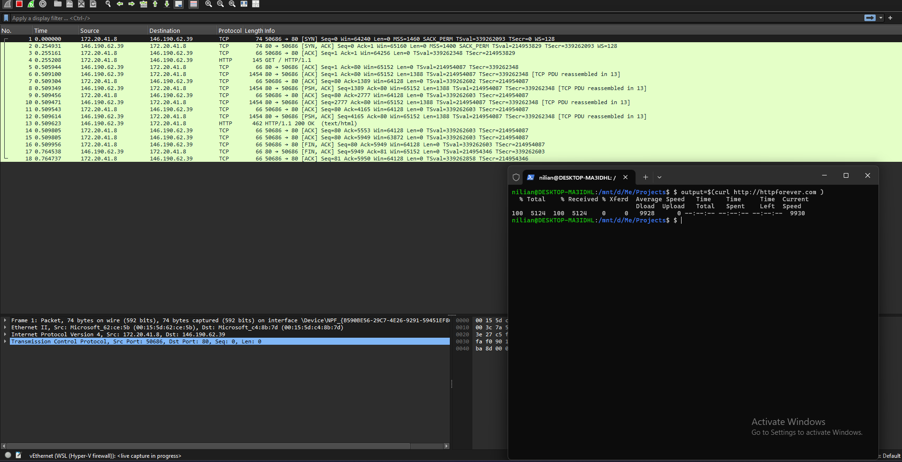

# Wireshark HTTP Packet Capture Analysis

## Environment Setup: WSL

To minimize network traffic noise and isolate HTTP packets for clearer analysis, I used my Debian distribution running on Windows Subsystem for Linux (WSL). This approach ensures that the captured traffic is limited to the specific Linux environment, avoiding interference from host machine background processes.

## Wireshark Configuration

1. Launch Wireshark with appropriate privileges
2. Select the WSL network interface (typically the virtual Ethernet adapter assigned to WSL)
3. Apply HTTP filter or simply monitor traffic to isolate HTTP protocol packets

## Generating HTTP Traffic

For generating clean HTTP traffic, I utilized [httpforever](http://httpforever.com/), a website that deliberately serves content over the unencrypted HTTP protocol rather than HTTPS. This makes it ideal for educational packet analysis since the traffic is not encrypted.

To generate HTTP requests:
```bash
curl http://httpforever.com
```

This command sends an HTTP GET request to the server and displays the response HTML in the terminal, while Wireshark captures all packets exchanged during this session.

## Packet Analysis Results

The capture reveals the complete HTTP communication cycle:



### Key Observations from the Capture:

1. **TCP Three-Way Handshake**: Initial packets show SYN, SYN-ACK, ACK establishing the connection
2. **HTTP Request**: The actual GET request to `http://httpforever.com`
3. **HTTP Response**: Server response with status code 200 OK
4. **TCP Termination**: FIN/ACK packets closing the connection

### HTTP Protocol Details Visible:
- **Request Headers**: User-Agent, Accept, Host fields
- **Response Headers**: Content-Type, Content-Length, Server information
- **Payload**: The actual HTML content being transferred

This simple HTTP capture demonstrates the fundamental request-response pattern of web communication and provides insight into how application layer protocols operate over TCP/IP.